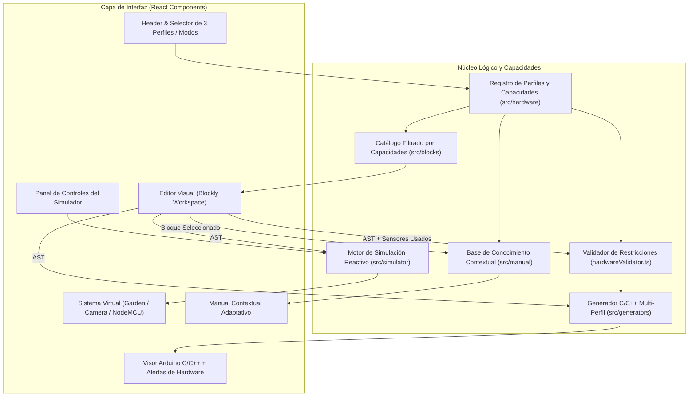

# Arquitectura de Software — Bi-Tech IoT Studio

## 1. Principios Arquitectónicos
1. **Separación de responsabilidades:** El editor visual, el generador de código, el validador de capacidades, el simulador pedagógico, los perfiles de hardware y el manual contextual son módulos independientes comunicados mediante contratos tipados en TypeScript.
2. **Arquitectura guiada por capacidades (`HardwareCapabilities`):** Ningún componente visual ni catálogo de bloques utiliza condicionales acoplados al nombre de una placa (`if device === 'nodemcu'`). Cada perfil declara sus capacidades físicas (`analogInputs`, `digitalInputs`, `digitalOutputs`, `relayChannels`, `camera`, `wifi`, `compatibleSensors`, `compatibleActuators`) y el sistema adapta bloques, validaciones y simuladores en función de dichas capacidades.
3. **Validación pedagógica de restricciones físicas (`hardwareValidator.ts`):** El entorno verifica que el algoritmo construido no exceda los recursos físicos del dispositivo seleccionado (por ejemplo, impidiendo silenciosamente usar más de 1 entrada analógica en `NodeMCU — ESP8266` y mostrando una advertencia didáctica clara).
4. **Configuración centralizada de hardware:** Ningún bloque ni componente visual contiene números de pines GPIO ni URLs de streaming codificados de forma rígida (*hardcoded*).

---

## 2. Stack Tecnológico (V0.1.1)
- **Framework UI:** `React 18+` con `TypeScript` estricto.
- **Empaquetador:** `Vite`.
- **Motor de programación visual:** `Blockly` (`blockly`).
- **Estilos e iconografía:** `Tailwind CSS` + `Lucide React`.
- **Pruebas automatizadas:** `Vitest` (unitarias) + `Playwright` (verificación E2E en navegador).

---

## 3. Diagrama de Módulos

---

## 4. Estructura de Directorios en `src/`

- **`src/types/`**: Contratos tipados para perfiles, `HardwareCapabilities`, `HardwareValidationIssue`, estados de simulación (`Garden`, `Camera`, `NodeMCU`) y AST del programa.
- **`src/hardware/`**:
  - `gardenNodeConfig.ts`: Perfil **Garden Node Bi-Tech — ESP32** (`analogInputs: 4`, `relayChannels: 2`).
  - `cameraNodeConfig.ts`: Perfil **Camera Node Bi-Tech — ESP32-CAM** (`camera: true`, programación USB, streaming Wi-Fi).
  - `nodeMcuConfig.ts`: Perfil **NodeMCU — ESP8266** (`analogInputs: 1` en pin `A0`, `DHT11`, E/S digitales, relay e iluminación).
  - `hardwareCapabilities.ts`: Registro centralizado `HARDWARE_PROFILES_REGISTRY` y funciones de filtrado por capacidades.
  - `hardwareValidator.ts`: Validador `validateProgramAgainstCapabilities(program)` que detecta excesos de entradas analógicas u otros recursos no soportados.
- **`src/blocks/`**: Bloques personalizados Blockly y extractor AST `parseWorkspaceToProgram`.
- **`src/generators/`**: Generador `generateArduinoCode` con soporte para `ESP32`, `ESP32-CAM` y `ESP8266`.
- **`src/simulator/`**: Evaluadores reactivos `evaluateGardenProgram`, `evaluateNodeMcuProgram` y `evaluateCameraProgram`.
- **`src/manual/`**: Diccionario pedagógico contextual con notas específicas por dispositivo (`getManualEntryForDevice`).
