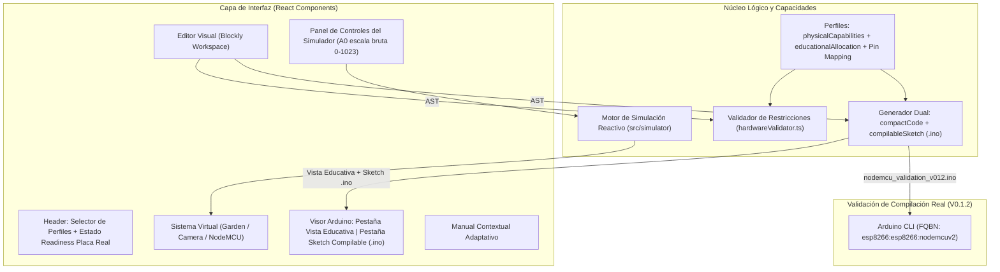

# Arquitectura de Software — Bi-Tech IoT Studio

## 1. Principios Arquitectónicos
1. **Separación de responsabilidades:** El editor visual, el generador de código dual, el validador de capacidades, el simulador pedagógico, los perfiles de hardware y el manual contextual son módulos independientes comunicados mediante contratos tipados en TypeScript.
2. **Distinción entre Capacidades Físicas y Perfil Educativo (`physicalCapabilities` vs `educationalAllocation`):** Cada dispositivo declara tanto sus recursos físicos reales (p. ej., `9` GPIOs digitales `D0–D8` y `1` canal ADC `A0` en NodeMCU ESP8266) como el subconjunto seguro habilitado para el trabajo didáctico en aula, evitando ocultar o distorsionar las características reales del microcontrolador.
3. **Nomenclatura explícita `Etiqueta de Placa → GPIO Real`:** Los perfiles de hardware registran la etiqueta impresa en la placa (`D1`, `D2`, `A0`) junto con el número de GPIO real del chip (`GPIO5`, `GPIO4`, `ADC0`), manteniendo `verifiedGpio: null` hasta cerrar el cableado definitivo de aula y utilizando pines candidatos seguros para la compilación.
4. **Doble salida de código Arduino C/C++ (`Vista educativa` vs `Sketch compilable .ino`):**
   - **Vista educativa (`compactCode`):** presenta `setup()` y `loop()` de forma limpia y sincronizada línea por línea con los bloques visuales.
   - **Sketch completo para hardware (`compilableSketch`):** genera un archivo `.ino` autocontenido con `#include` condicionales según los bloques usados, `#define` de pines comentados (`D1 -> GPIO5`), estados iniciales seguros (`relayOff()`), `setup()`, `loop()` e implementación completa de las funciones auxiliares, listo para compilar con `arduino-cli`.

---

## 2. Stack Tecnológico (V0.1.2)
- **Framework UI:** `React 18+` con `TypeScript` estricto.
- **Empaquetador:** `Vite`.
- **Motor de programación visual:** `Blockly` (`blockly`).
- **Estilos e iconografía:** `Tailwind CSS` + `Lucide React`.
- **Validación de compilación de hardware:** `Arduino CLI 1.5.1` (`esp8266:esp8266@3.1.2`, FQBN `esp8266:esp8266:nodemcuv2`).
- **Pruebas automatizadas:** `Vitest` (unitarias) + `Playwright` (verificación E2E en navegador).

---

## 3. Diagrama de Módulos y Flujo de Hardware Readiness

---

## 4. Estructura de Directorios en `src/` y `evidence/`

- **`src/types/`**: Contratos tipados para `PhysicalHardwareCapabilities`, `EducationalProfileAllocation`, `BoardPinReference`, `SymbolicPinAssignment`, `AdcVoltageRangeStatus` y `GeneratedArduinoOutput`.
- **`src/hardware/`**:
  - `nodeMcuConfig.ts`: Perfil **NodeMCU — ESP8266** con FQBN `esp8266:esp8266:nodemcuv2`, `adcInputVoltageRange: 'unverified'` y tabla `D0–D8 / A0 → GPIO`.
  - `gardenNodeConfig.ts`: Perfil **Garden Node Bi-Tech — ESP32**.
  - `cameraNodeConfig.ts`: Perfil **Camera Node Bi-Tech — ESP32-CAM**.
  - `hardwareCapabilities.ts` y `hardwareValidator.ts`.
- **`src/generators/arduinoGenerator.ts`**: Generador dual (`compactCode` + `compilableSketch`).
- **`evidence/hardware/nodemcu_validation_v012/`**: Sketch `.ino` generado desde bloques y log de compilación real con `arduino-cli`.
