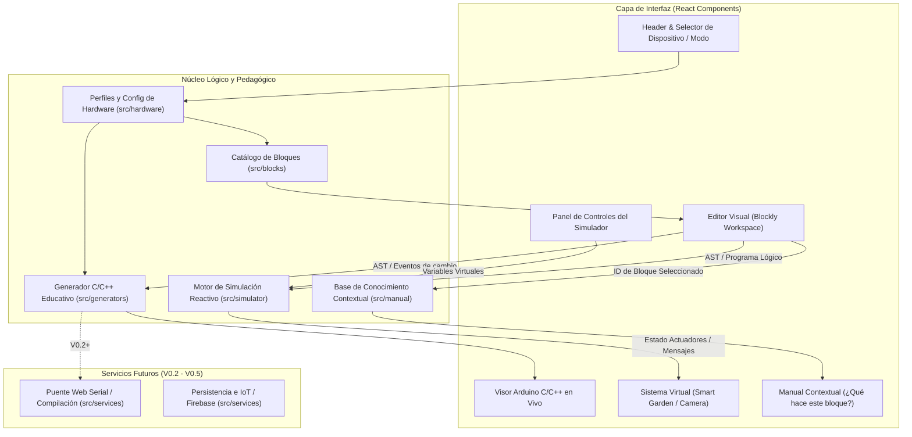

# Arquitectura de Software — Bi-Tech IoT Studio

## 1. Principios Arquitectónicos
1. **Separación de responsabilidades:** El editor visual, el generador de código, el simulador pedagógico, los perfiles de hardware y el manual contextual son módulos independientes comunicados mediante contratos tipados en TypeScript.
2. **Independencia del hardware real en el simulador:** El simulador evalúa el modelo lógico del programa sobre un estado virtual de sensores y actuadores, sin requerir una placa física conectada.
3. **Independencia de la interfaz en el generador de código:** El generador traduce el árbol sintáctico de bloques a código Arduino C/C++ educativo apoyándose en el perfil de hardware seleccionado.
4. **Configuración centralizada de hardware:** Ningún bloque ni componente visual contiene números de pines GPIO ni URLs de streaming codificados de forma rígida (*hardcoded*).

---

## 2. Stack Tecnológico Seleccionado (V0.1)
- **Framework UI:** `React 18+` con `TypeScript` (tipado estricto para estados de simulación, bloques y perfiles de dispositivos).
- **Empaquetador y entorno de desarrollo:** `Vite` (arranque rápido, soporte nativo de módulos ES y variables de entorno).
- **Motor de programación visual:** `Blockly` (`blockly` oficial de Google) por su madurez para definir bloques personalizados, generadores de código a medida y eventos de selección de bloques.
- **Estilos e iconografía:** `Tailwind CSS` + `Lucide React` para replicar con fidelidad, accesibilidad y diseño *responsive* la jerarquía visual de referencia.

---

## 3. Diagrama de Módulos

---

## 4. Estructura de Directorios en `src/`

- **`src/types/`**: Definiciones de tipos para dispositivos (`DeviceProfileId`), estados de sensores (`GardenSensorState`), estados de actuadores (`GardenActuatorState`), estado de cámara (`CameraNodeState`), metadatos de bloques y entradas del manual contextual.
- **`src/hardware/`**:
  - `gardenNodeConfig.ts`: Definición simbólica de pines (`DHT_PIN`, `SUELO_PIN`, `LDR_PIN`, `BOMBA_PIN`, `LUZ_PIN`), polaridad del relay (`activeLow: boolean`) y estado seguro inicial (`OFF`).
  - `cameraNodeConfig.ts`: Configuración simbólica para `ESP32-CAM` (`OV2640`), resoluciones soportadas y URL de streaming configurable.
- **`src/blocks/`**: Definición de bloques Blockly organizados en categorías (`Inicio`, `Sensores`, `Control`, `Actuadores`, `Cámara`, `Datos`, `IoT`).
- **`src/generators/`**: Generador de código Arduino C/C++ que emite funciones educativas claras (`leerHumedadSuelo()`, `bombaOn()`, `iniciarStreaming()`, etc.) y mapea cada bloque con su rango de líneas para resaltado en vivo.
- **`src/simulator/`**: Intérprete pedagógico seguro que evalúa las condiciones del programa de bloques frente a los valores actuales de los sliders del simulador y actualiza el estado de la bomba, la iluminación o la cámara virtual.
- **`src/manual/`**: Diccionario pedagógico indexado por tipo de bloque con descripción funcional, componente físico asociado, tipo de dato, código C/C++ equivalente y advertencias técnicas (ej. calibración analógica).
- **`src/services/`**: Interfaces preparadas (*stubs* documentados) para compilación/flasheo (`V0.2`), streaming MJPEG (`V0.3`), telemetría IoT (`V0.4`) y Firebase (`V0.5`).
