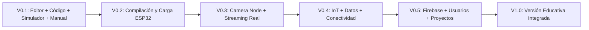

# Hoja de Ruta (Roadmap) — Bi-Tech IoT Studio

El desarrollo de **Bi-Tech IoT Studio** se organiza de manera incremental y documentada en seis hitos evolutivos:

---

## 🟢 V0.1 — Entorno Pedagógico Base (Alcance Actual)
**Objetivo:** Demostrar el ciclo completo **PROGRAMAR → COMPRENDER → PROBAR** de forma local.
- Selector de dispositivo: **Garden Node Bi-Tech (`ESP32`)** y **Camera Node Bi-Tech (`ESP32-CAM`)**.
- Selector de modos de trabajo: **Programar**, **Simular**, **Placa real** (preparado conceptualmente).
- Editor visual basado en **Blockly** con categorías: `Inicio`, `Sensores`, `Control`, `Actuadores`, `Cámara`, `Datos` (base), `IoT` (conceptual).
- Generador de código **Arduino C/C++** en vivo con funciones educativas claras y resaltado contextual.
- **Simulador pedagógico del Garden Node:** Sliders interactivos para temperatura, humedad ambiente, humedad del suelo y nivel de luz; respuesta en vivo de bomba e iluminación virtual.
- **Simulador pedagógico del Camera Node:** Estado de cámara, resolución, calidad, estado de streaming, contador de capturas y marca temporal de última captura.
- **Manual contextual integrado:** Panel *¿Qué hace este bloque?* con explicación pedagógica, hardware, tipo de dato y código.

---

## 🟡 V0.2 — Programación de Hardware Real (ESP32)
**Objetivo:** Habilitar el modo **Placa real** para transferir los programas generados al `Garden Node`.
- Verificación y cierre de supuestos de pines GPIO reales y polaridad del relay en laboratorio.
- Evaluación e integración de transferencia por USB (`Web Serial API` / `esptool-js` / servicio de compilación con `Arduino CLI`).
- Monitor serie educativo integrado para observar lecturas reales de sensores.

---

## 🟠 V0.3 — Integración Completa de Camera Node y Streaming Real
**Objetivo:** Vincular el programa de la `ESP32-CAM` con el streaming Wi-Fi real en el panel del entorno.
- Flujo completo: carga por USB → reinicio → conexión Wi-Fi → visualización del stream MJPEG y capturas reales dentro de Bi-Tech IoT Studio.
- Configuración segura de parámetros de red local y endpoint de cámara verificado.

---

## 🔵 V0.4 — IoT, Datos y Conectividad
**Objetivo:** Activar las categorías de `Datos` e `IoT` para registro de series temporales y comunicación entre nodos.
- Registro de lecturas de sensores a lo largo del tiempo (tablas y gráficos pedagógicos).
- Envío y recepción de eventos entre `Garden Node` y `Camera Node` (ej. tomar una captura fotográfica cada vez que se activa el riego).

---

## 🟣 V0.5 — Plataforma con Firebase, Usuarios y Proyectos
**Objetivo:** Persistencia en la nube y gestión áulica.
- Autenticación de estudiantes y docentes.
- Guardado, versionado y compartición de proyectos de bloques.
- Almacenamiento de bitácoras de datos IoT del *Smart Garden Lab*.

---

## 🌟 V1.0 — Primera Versión Educativa Integrada
**Objetivo:** Lanzamiento consolidado y validado en aula en **Escuela Estación Buenos Aires**.
- Guías didácticas integradas, secuencias de actividades por nivel y validación completa con hardware físico y nube.
