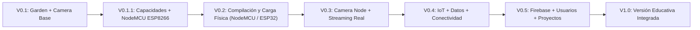

# Hoja de Ruta (Roadmap) — Bi-Tech IoT Studio

---

## ✅ V0.1 — Entorno Pedagógico Base (Completado)
- Editor visual Blockly + Generador Arduino C/C++ en vivo + Simulador pedagógico + Manual contextual para `Garden Node Bi-Tech (ESP32)` y `Camera Node Bi-Tech (ESP32-CAM)`.

---

## 🟢 V0.1.1 — Capacidades de Hardware y Soporte Oficial para NodeMCU ESP8266 (Actual)
- Capa declarativa centralizada `HardwareCapabilities` (`src/hardware/hardwareCapabilities.ts`).
- Tercer perfil oficial: **NodeMCU — ESP8266** (`DHT11`, única entrada analógica `A0`, entrada/salida digital, relay, iluminación y Wi-Fi).
- Validador pedagógico de restricciones físicas (`src/hardware/hardwareValidator.ts`): alerta explícita cuando un proyecto solicita más entradas analógicas que las disponibles en el dispositivo seleccionado.
- Simulador interactivo específico para NodeMCU ESP8266 y adaptación del Manual Contextual según el hardware activo.

---

## 🟡 V0.2 — Programación de Hardware Real (Validación Inicial con NodeMCU ESP8266 y ESP32)
- Primera validación física real del flujo completo: **Blockly → Arduino C/C++ → Compilación → USB → Placa física**, utilizando la placa **NodeMCU ESP8266** disponible en laboratorio y posteriormente el **ESP32**.
- Relevamiento y cierre de asignación de pines GPIO reales (`SP-01` a `SP-14`).
- Habilitación del modo **Placa real** y monitor serie educativo.

---

## 🟠 V0.3 — Integración Completa de Camera Node y Streaming Real
- Vinculación de la `ESP32-CAM` programada por USB con el streaming MJPEG real vía Wi-Fi dentro del entorno.

---

## 🔵 V0.4 — IoT, Datos y Conectividad
- Series temporales, gráficos de sensores y comunicación de eventos IoT entre nodos (`Garden Node`, `NodeMCU` y `Camera Node`).

---

## 🟣 V0.5 — Plataforma con Firebase, Usuarios y Proyectos
- Persistencia en la nube, cuentas de estudiantes/docentes y gestión de proyectos áulicos.

---

## 🌟 V1.0 — Primera Versión Educativa Integrada
- Lanzamiento consolidado y validado en aula en **Escuela Estación Buenos Aires**.
