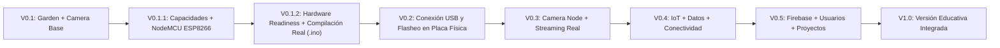

# Hoja de Ruta (Roadmap) — Bi-Tech IoT Studio

---

## ✅ V0.1 — Entorno Pedagógico Base (Completado)
- Editor visual Blockly + Generador Arduino C/C++ en vivo + Simulador pedagógico + Manual contextual para `Garden Node Bi-Tech (ESP32)` y `Camera Node Bi-Tech (ESP32-CAM)`.

---

## ✅ V0.1.1 — Capacidades de Hardware y Soporte Oficial para NodeMCU ESP8266 (Completado)
- Capa declarativa centralizada `HardwareCapabilities` y tercer perfil oficial **NodeMCU — ESP8266** con validador pedagógico de restricciones físicas (`1` entrada analógica `A0`).

---

## ✅ V0.1.2 — Hardware Readiness y Validación de Compilación Real (Completado)
- Distinción explícita entre **capacidades físicas del hardware** (`9` GPIOs `D0–D8` en NodeMCU) y **recursos habilitados por el perfil educativo**.
- Mapeo explícito entre **etiquetas serigrafiadas en placa (`D0–D8`, `A0`)** y **GPIOs reales del ESP8266 (`D1 → GPIO5`, etc.)**, manteniendo abierto el cableado definitivo de aula (`verifiedGpio: null`).
- Configuración de `A0` en escala bruta (`0–1023`) con parámetro verificable `adcInputVoltageRange: 'unverified'`.
- Separación en la interfaz y en el generador entre **Vista educativa** y **Sketch compilable (`.ino`)**.
- Verificación de compilación real con **Arduino CLI (`1.5.1`)** y core **`esp8266:esp8266@3.1.2`** bajo el FQBN **`esp8266:esp8266:nodemcuv2`**.

---

## ✅ V0.2A — Primera Transferencia a Hardware Real con NodeMCU ESP8266 (Completado)
- **Hito alcanzado:** Primera transferencia real de un programa originado en Bi-Tech IoT Studio hacia hardware físico NodeMCU ESP8266.
- Validación física real del flujo completo: **Blockly → Arduino C/C++ → Compilación → USB (`COM15`) → NodeMCU ESP8266 (`ESP8266EX` 4MB) → Ejecución física (`LED_BUILTIN` + Monitor Serie @ `115200` baudios)**.
- Evidencia sanitizada registrada en [`evidence/hardware/nodemcu-first-flash/`](file:///j:/Bi-Tech-IoT-Studio/evidence/hardware/nodemcu-first-flash/README.md).

---

## ✅ V0.2B — Primera Salida Física con Relay en NodeMCU ESP8266 (Completado)
- **Hito alcanzado:** `Bi-Tech IoT Studio → Blockly → Arduino C/C++ → compilación → USB → NodeMCU → GPIO5 → relay físico`.
- Pin verificado para el primer canal de relay: **`D1 → GPIO5`** (`RELAY_PIN`), con conmutación física cada 2 segundos y telemetría serie (`Relay ON` / `Relay OFF`).
- Evidencia sanitizada registrada en [`evidence/hardware/nodemcu-relay-first-control/`](file:///j:/Bi-Tech-IoT-Studio/evidence/hardware/nodemcu-relay-first-control/README.md).

---

## 🟡 V0.2C — Segundo Canal de Relay / Iluminación y Validación Progresiva de Hardware (Próxima Etapa)
- Ensayo físico del segundo canal del módulo relay / iluminación antes de conectar la bomba.
- Relevamiento de polaridad con carga conectada y pruebas de sensores (`A0` / `DHT11`).

---

## 🟠 V0.3 — Integración Completa de Camera Node y Streaming Real
- Vinculación de la `ESP32-CAM` programada por USB con el streaming MJPEG real vía Wi-Fi dentro del entorno.

---

## 🔵 V0.4 — IoT, Datos y Conectividad
- Series temporales, gráficos de sensores y comunicación de eventos IoT entre nodos (`Garden Node`, `NodeMCU` y `Camera Node`).

---

## 🟣 V0.5 — Plataforma con Firebase, Usuarios y Proyectos
- Persistencia en la nube, cuentas de estudiantes/docentes y gestión de proyectos áulicos.

---

## 🌟 V1.0 — Primera Versión Educativa Integrada
- Lanzamiento consolidado y validado en aula en **Escuela Estación Buenos Aires**.
